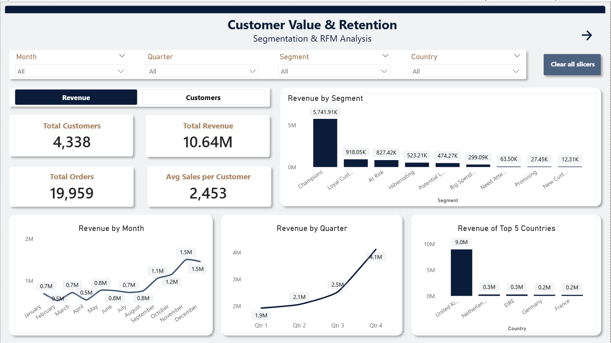
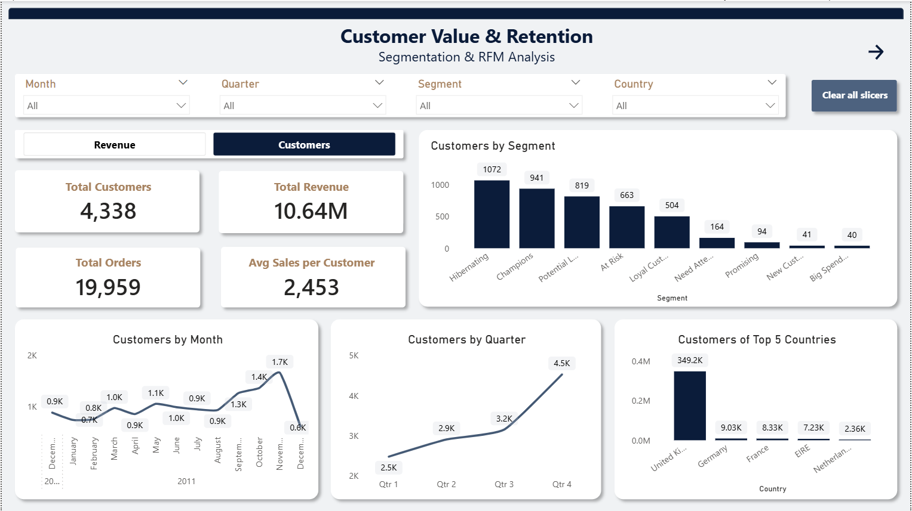
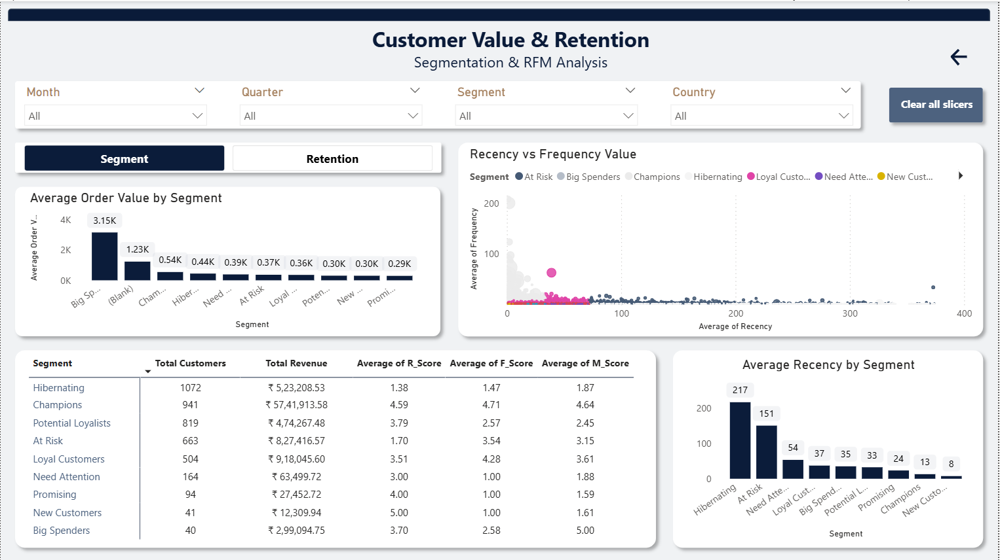
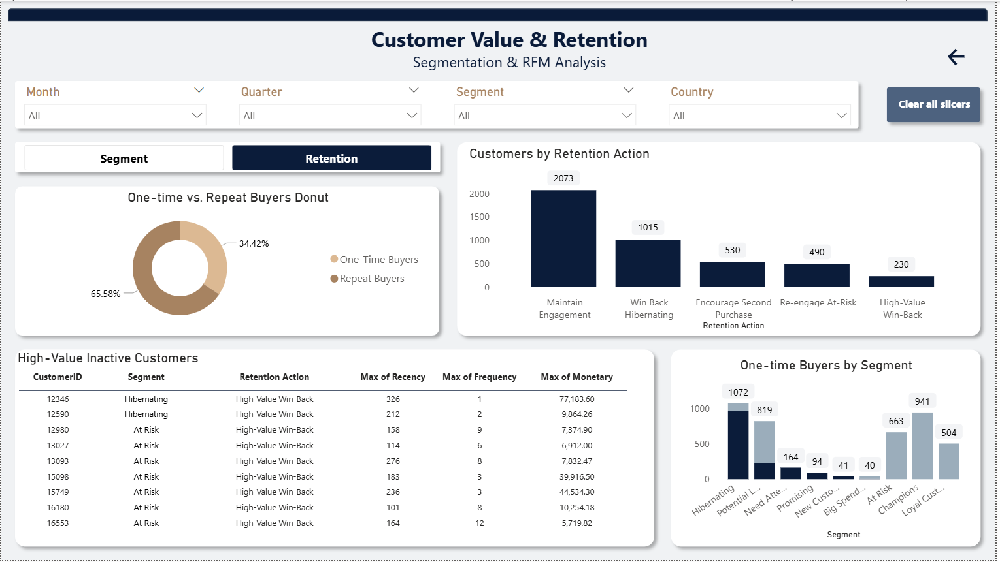

# Customer Segmentation and RFM Analysis

**Understanding customer purchasing behaviour and identifying customer groups for better retention and marketing decisions.**

## Project Overview

Understanding which customers contribute most to business revenue is important for making better marketing and retention decisions. However, looking at total sales alone does not explain how recently customers purchased, how frequently they return, or how much they spend.

The analysis focuses on customer value, purchase frequency, and the time elapsed since a customer's last purchase. I applied the Recency, Frequency, and Monetary (RFM) framework to group customers into segments such as Champions and Hibernating customers.

The main purpose was to move beyond overall sales figures and understand which customer groups a retail business should retain, engage, or re-engage.

## Business Problem

A retail business does not get the same value from every customer. Some customers purchase regularly and contribute a large share of revenue, while others purchase occasionally or have not returned for a long time.

Without understanding these differences, businesses may spend marketing resources in the same way across all customers. This can lead to missed opportunities to retain valuable customers and reconnect with customers who have become inactive.

I approached this problem by examining customer transaction history and using RFM analysis to understand three things:

- When did each customer last purchase?
- How frequently did each customer make purchases?
- How much did each customer spend?

The resulting segments provide a practical way to identify customer groups that may need different retention and marketing strategies.

## Project Objectives

The main objectives were to:

- Explore historical retail transactions and understand purchasing patterns.
- Assess data quality and prepare the transaction data for analysis.
- Calculate customer-level Recency, Frequency, and Monetary metrics.
- Assign RFM scores and group customers into meaningful segments.
- Identify high-value and inactive customer groups.
- Compare customer segments by size and monetary contribution.
- Build a Power BI report to communicate the findings and support business decisions.

## Dataset Information

**Dataset source:** [UCI Online Retail Dataset](https://archive.ics.uci.edu/dataset/352/online+retail)

The dataset contains historical transactions from a UK-based online retailer. It covers transactions between December 2010 and December 2011 and includes purchases made by customers across multiple countries.

## Project Workflow

1. **Dataset loading and inspection:** Loaded the Online Retail dataset and reviewed its structure, columns, and basic statistics.
2. **Data quality assessment:** Checked duplicate records, missing values, data types, and invalid transaction values.
3. **Data cleaning and preparation:** Prepared the transaction data for sales and customer-level analysis.
4. **Exploratory data analysis:** Examined sales, orders, products, countries, and customer purchasing patterns.
5. **RFM calculation:** Calculated customer Recency, Frequency, and Monetary values.
6. **Customer scoring and segmentation:** Applied RFM scores and assigned customer segments.
7. **Segment analysis:** Compared customer counts, customer value, and segment-level sales contribution.
8. **Power BI development:** Created dashboard views to present business performance and customer segmentation.
9. **Business recommendations:** Identified possible retention and engagement actions based on the results.

## Customer Segmentation Results

The analysis produced **4,338 valid customer-level RFM records**.

Two important findings from the segmentation were:

| Segment | Customers | Monetary / Sales Finding | Business Interpretation |
|---|---:|---:|---|
| Champions | 911 | 63.87% of sales | A relatively small group of valuable customers contributing a large share of sales. |
| Hibernating | 1,335 | 681,943.02 monetary value | Customers with low recent activity who may be considered for re-engagement.

### Dashboard Screenshots

**Executive Overview**

**Customer Segmentation and RFM**

